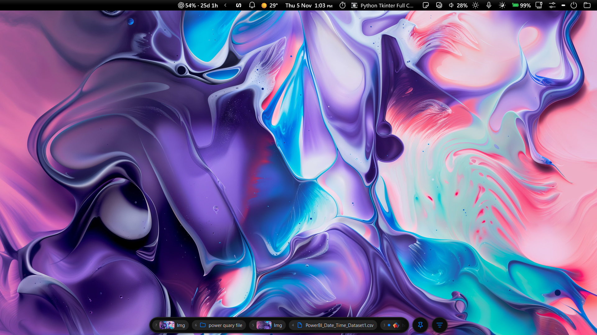
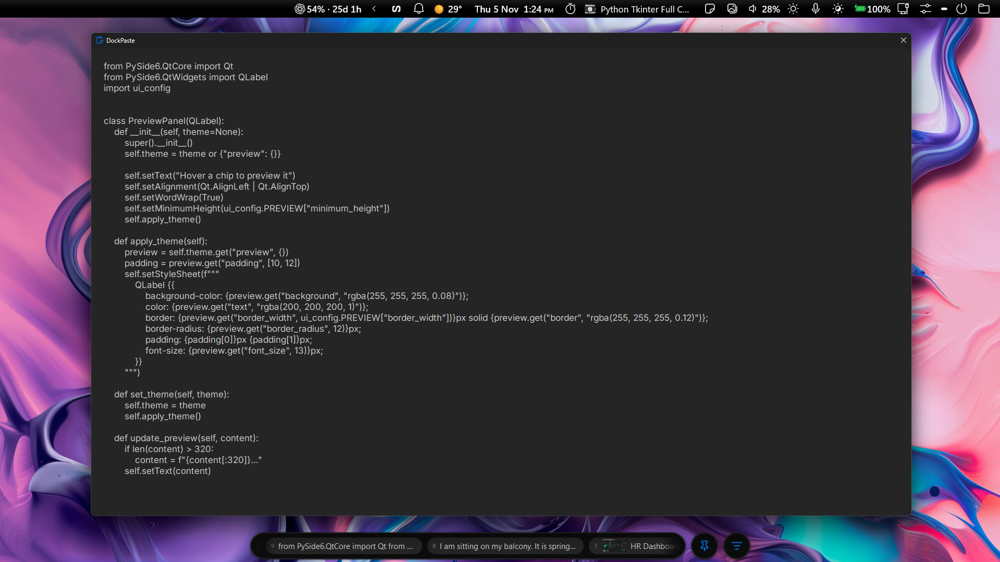
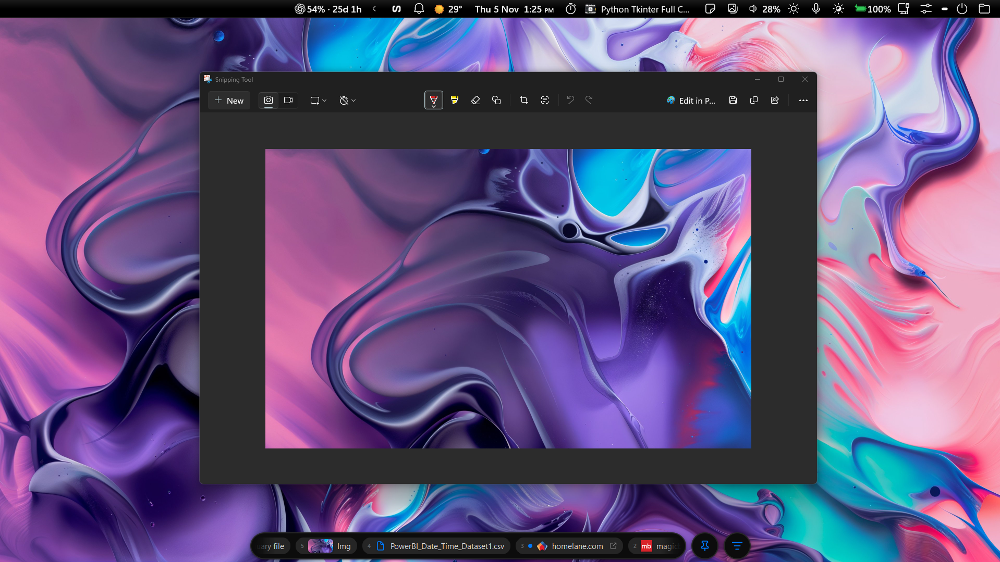
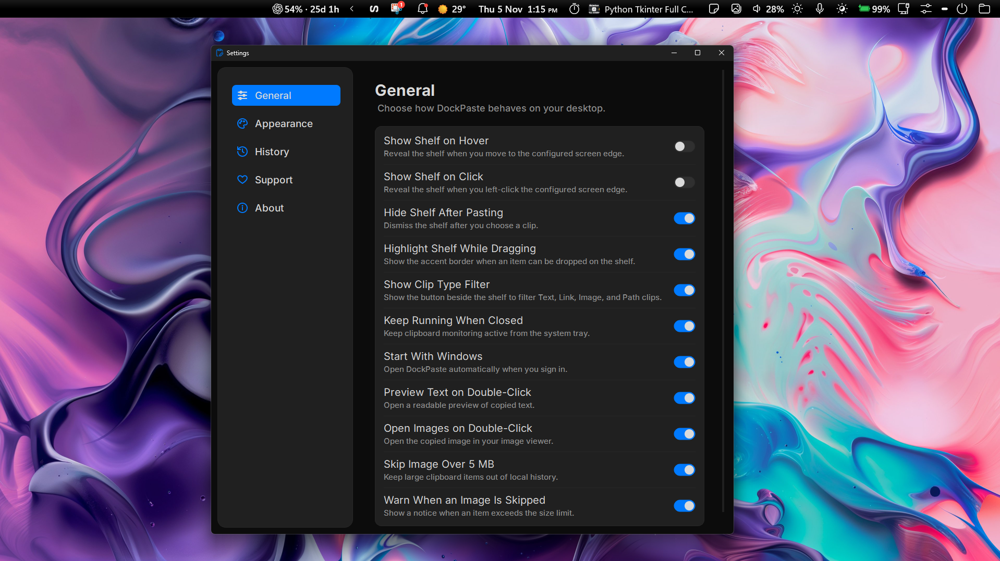
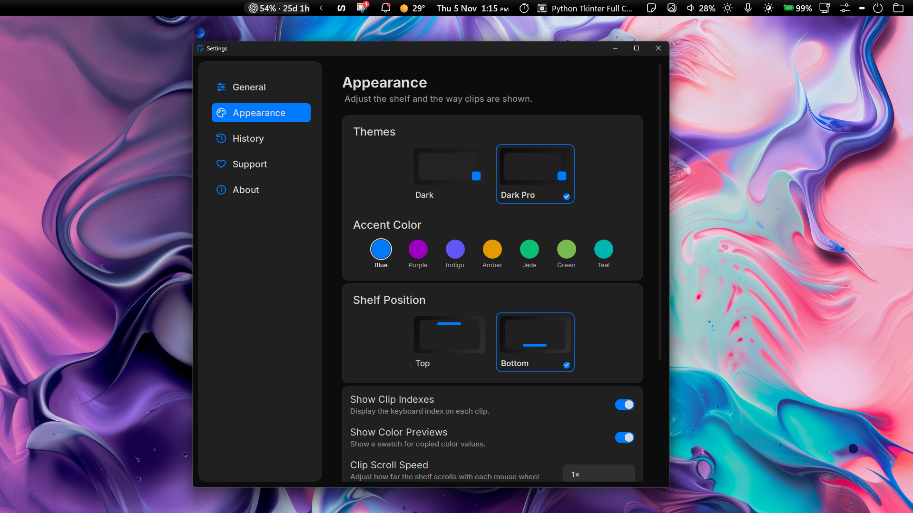
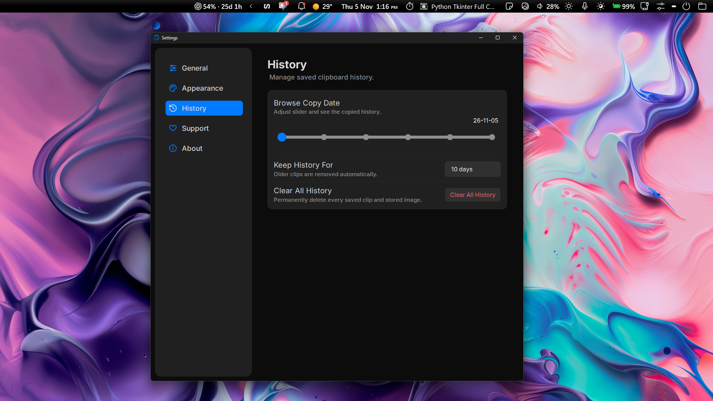

# DockPaste

DockPaste is a lightweight clipboard history shelf built with Python, PySide6, and Qt. It keeps recently copied items close at hand so you can find and paste them again without switching to a separate clipboard manager.

DockPaste is still a work in progress, so you might run into a few bugs or unfinished bits.

## About

I started DockPaste with no app development experience. The idea came to me, and I shaped it into an app as I learned along the way. I’m sharing it openly so anyone can help fix bugs, solve problems, and make DockPaste better.

## Features

- Store unlimited number of clips.
- Automatically saves copied text, links, file, folders, images, and screenshots.
- Drag and drop text, links, files, folders and images into the shelf.
- Click/drag and drop clips to paste it into the active app.
- Pin clips, delete individual clips, or clear all unpinned clips.
- Show color previews and website favicons on supported clips.
- Preview text or open copied images on double-click.
- Browse history by copy date.
- Adjust shelf size and clips size.
- Optionally skip text and image items larger than 5 MB and show a warning when an item is skipped. Ordinary files and folders are stored as paths and are exempt from this size limit.
- Choose how long to keep history in Settings (1–30 days; 10 days by default). Expired clips, including pinned clips, are removed automatically.
- On Windows, press **Ctrl + Win** to pin or unpin the shelf.

## DockPaste

---
## Pin/Uppin

---
## Filter

### Texts

### Links

### Screen-shots

### Files/Folders/Images

---
## Preview

### Text

## Image

---
## Settings

### General

### Apperance

### History

---
## Install on Windows

1. Open the [latest GitHub release](https://github.com/NishantSingh359/DockPaste/releases).
2. Download and run `DockPaste-Setup-v1.6.exe`.
3. Follow the installer, then launch DockPaste from the Start menu or the optional desktop shortcut.

DockPaste currently provides a Windows installer for 64-bit Windows 10 and Windows 11.

---
## Windows SmartScreen

Because DockPaste is an unsigned indie and open-source app, Windows may display “Windows protected your PC.” If you trust the installer, select **More info**, then **Run anyway**.

---
## Privacy

Clipboard history and settings are stored locally on your device. DockPaste does not sync clipboard data to the cloud or include telemetry. When link favicons or copied remote images are used, DockPaste may contact the corresponding website to retrieve them. Old history is removed automatically according to the retention setting.

## Contributing

DockPaste is an open-source project, and everyone is welcome to help make it better. Report bugs, suggest improvements, or submit a fix through the [GitHub repository](https://github.com/NishantSingh359/DockPaste).
